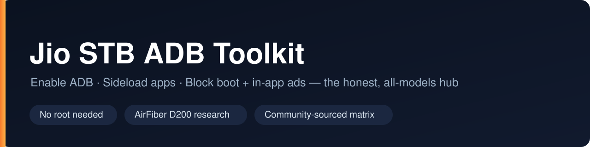
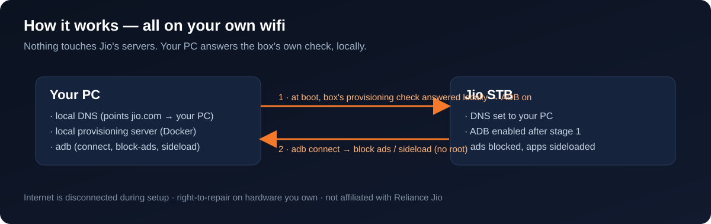

<p align="center">
  
</p>

# Jio STB ADB Toolkit

> A single, honest, beginner-friendly hub for enabling **ADB**, **sideloading apps**, installing a **custom launcher**, and (where it's actually possible) **unlocking** Jio set-top boxes — with a clear, maintained status page for the locked-down **AirFiber (JMSD200)** boxes.


[](https://github.com/Aashish-Jha-11/jio-stb-adb-toolkit/actions/workflows/ci.yml)

---

> [!WARNING]
> **Read this first.**
> - These are **your own devices** and everything here runs on **your own local network** — none of it touches Jio's servers.
> - Jio set-top boxes are usually **leased**, not owned. Modifying one may **breach Jio's terms** and void any support. That's your call to make for your hardware.
> - The bootloader-unlock path can **permanently brick** a box. The sideload path is much safer but is not risk-free.
> - Everything is **model- and firmware-specific**. Using the wrong steps for your build can fail or make things worse. **Always check the [compatibility matrix](docs/compatibility.md) for your exact model first.**
> - This project is **not affiliated with, endorsed by, or connected to Reliance Jio.** It links to third-party research; we don't host anyone's exploit payloads.

---

## What this is

A lot of Jio STB knowledge is scattered across forum posts and a couple of model-specific repos. This project pulls it into **one place**, written so **anyone can follow it**, with an honest answer to the first question everyone asks:

**"Can I do this on *my* box?"** → see the [compatibility matrix](docs/compatibility.md).

## What you can (and can't) do, by model

| Model | Network-ADB + sideload | Custom launcher / block ads | Bootloader unlock / root | Status |
|---|:---:|:---:|:---:|---|
| **JMSC200Av2** | ✅ public method | ✅ | ✅ (firmware patch level **before Jun 2024**) | Best supported |
| **JMSB200A** | ✅ public method | ✅ | ⚠️ unverified | Supported |
| **JHSC200 v1** | ✅ public method | ✅ | ❌ | Sideload only |
| **JMSD200Av2** (AirFiber) | ⚠️ **reported working** (stage 1) | ⚠️ follows from ADB | ⚠️ untested (secure boot) | 🔬 [Research / WIP](docs/airfiber-jmsd200.md) |

> The matrix is **community-sourced** — if you have first-hand results, please [correct it via PR](CONTRIBUTING.md). Honesty is the whole point of this repo.

## Screenshots

_Screenshots of a real modded box are the most convincing thing you can add._ Capture these on your box and drop the PNGs into `assets/` (named as below) — they'll render here automatically:

1. **Before** — stock launcher with ads, or the boot ad.
2. **After** — clean launcher, no ads.
3. **Proof** — your PC terminal showing `adb devices` listing the box.

| Before (stock + ads) | After (no ads) | `adb devices` proof |
|---|---|---|
| `assets/before.png` | `assets/after.png` | `assets/adb.png` |

## Quick start

1. **Find your model + firmware.** It's on a sticker under the box (`Model: ...`) and in **Settings → About / System**. You can also run the [doctor script](doctor/jio-stb-doctor.sh) once ADB is reachable.
2. **Look up your model** in the [compatibility matrix](docs/compatibility.md).
3. Follow the guide for your situation:
   - 🟢 **[Enable network ADB + sideload apps](docs/sideload-network-adb.md)** — the safe path. Install a launcher, sideload APKs.
   - 🚫 **[Block ads — boot + in-app](docs/block-ads.md)** — the most popular goal. Needs only ADB, **no root**.
   - 🔴 **[Unlock the bootloader](docs/unlock-bootloader.md)** — advanced, brick-risk, specific models only.
   - 🔬 **[AirFiber JMSD200 status](docs/airfiber-jmsd200.md)** — if you have the newer box, start here. Read it before you waste hours.
4. Stuck? See **[Troubleshooting](docs/troubleshooting.md)**.

## Full walkthrough — get to an ad-free box

> Everything from **step 3 onward needs no root** and is identical on every model. Getting ADB (step 2) is the only hands-on part: for **JMSC/JMSB/JHS** use the [safe path](docs/sideload-network-adb.md); for the **AirFiber D200** use the `Housekeeping-PoC` stage-1 tool (see [D200 status](docs/airfiber-jmsd200.md)).

### 0 · Install the tools (on your PC)
- **adb** (Android platform-tools), **Docker Desktop**, **Python 3**, **git**
- Clone with submodules, then check your environment:
```bash
git clone --recursive https://github.com/Aashish-Jha-11/jio-stb-adb-toolkit
cd jio-stb-adb-toolkit
./scripts/setup.sh
```

### 1 · Identify your box
Read the sticker under the box, or once ADB is up:
```bash
adb shell getprop ro.product.model
adb shell getprop ro.build.version.security_patch
```
Then find it in the [compatibility matrix](docs/compatibility.md).

### 2 · Enable ADB  ⚠️ (the one hands-on, slightly risky step)
This is the upstream part. Follow **[docs/sideload-network-adb.md](docs/sideload-network-adb.md)** (D200: the `Housekeeping-PoC` submodule). In short: point the box's DNS at your PC through the hidden Settings menu, run the upstream stage-1 tool, disconnect the internet, and **cold power-cycle** the box. Don't borrow steps from a model that isn't yours.

### 3 · Connect ADB (on your PC)
```bash
adb connect <box-ip>:5555
adb devices          # the box should list as "device"
```

### 4 · Block ads — no root
```bash
# 1) system-wide ad-blocking DNS
./scripts/block-ads.sh --ip <box-ip> --dns

# 2) find then disable the boot-ad / launcher package (reversible)
./scripts/block-ads.sh --list
./scripts/block-ads.sh --disable <package.name>
```
Manual commands and the "which package?" trick: **[docs/block-ads.md](docs/block-ads.md)**.

### 5 · Sideload apps (optional)
```bash
./scripts/sideload.sh --ip <box-ip> install yourapp.apk
./scripts/sideload.sh launcher        # install the bundled clean launcher
```

### 6 · Make it stick
Stage 1 blocks forced updates so Jio can't quietly re-enable ads or close ADB. If ads come back after an update, see **[troubleshooting](docs/troubleshooting.md)**.

## What's in the repo

This is a **working toolkit**, not just docs — it bundles both upstream projects' full code and adds first-party scripts:

```
jio-stb-adb-toolkit/
├─ scripts/
│  ├─ setup.sh            # prerequisite check + guided next steps
│  ├─ block-ads.sh        # kill boot + in-app ads over ADB (no root)
│  └─ sideload.sh         # install/manage apps over ADB
├─ doctor/jio-stb-doctor.sh   # read-only: detect model + firmware, pick a path
├─ docs/                  # per-model guides, compatibility matrix, troubleshooting
└─ third_party/           # full upstream code, included as submodules:
   ├─ sideload-jiostb/        # network-ADB + launcher (JMSC/JMSB/JHS)
   └─ Housekeeping-PoC/       # stage-1 ADB + unlock research (Apache-2.0)
```

Get the upstream code after cloning:

```bash
git clone --recursive <your-repo-url>
# or, if already cloned:
git submodule update --init --recursive
./scripts/setup.sh            # check your environment
```

## How it works (the short version)

<p align="center"></p>

The safe "network ADB" path doesn't attack anything — it points your box's **DNS at a small server running on your own PC** on your own LAN, so the box's own provisioning check is answered locally and lets you flip on wireless debugging. From there it's standard Android: `adb connect`, `adb install app.apk`. The deep "unlock" path additionally uses a **public, already-patched Android vulnerability** to reach the bootloader lock state on specific older firmware. Full details, with credit to the people who did the hard research, are in [CREDITS](CREDITS.md).

## Credits

This project **stands on the shoulders** of the people who actually did the reverse engineering. It organizes and documents their public work — it does not replace or repackage it. See **[CREDITS.md](CREDITS.md)**. If you're one of these authors and want something changed or removed, open an issue.

## Contributing

First-hand results — **especially from AirFiber JMSD200 owners** — are the most valuable thing you can add. See **[CONTRIBUTING.md](CONTRIBUTING.md)**.

## Legal & safety

For **personal, right-to-repair use on hardware you possess**, on your own network, only. You are responsible for complying with your local laws and your agreement with your service provider. See the warning box above and the per-guide disclaimers. **No warranty** — see [LICENSE](LICENSE).

---

⭐ If this saved you time or confusion, a star helps other Jio users find it.

**GitHub topics to add:** `jio` `jio-stb` `adb` `sideload` `android-tv` `set-top-box` `right-to-repair` `jio-airfiber` `amlogic`
